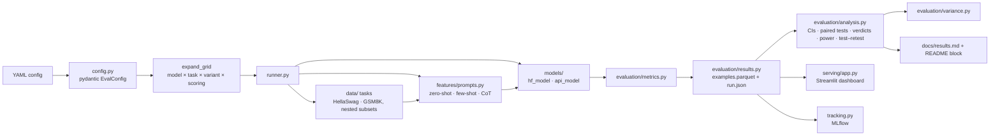

# llm-eval-harness

Evaluate small LLMs on HellaSwag and GSM8K and report the results the way a statistician would:
every accuracy carries a seeded bootstrap 95% CI and its `n`, every "A beats B" is a paired,
multiplicity-corrected test under a decision rule fixed before the data, the variance in scores is
split into model, prompt and interaction, and every config is rerun three times to measure
test–retest agreement.

**Models**: Qwen2.5-0.5B and Llama-3.2-1B locally (Hugging Face transformers, float32 on Apple
MPS); GPT-4o-mini and Claude Haiku 5.5 through their APIs (adapters and config included, run when
keys are set). **Tasks**: HellaSwag (500 validation examples) and GSM8K (300 test examples).
**Prompts**: zero-shot, few-shot (3 exemplars), chain-of-thought.

## Results

<!-- results:start (generated by `make analyze`; do not edit by hand) -->
Runs analysed: `local_ll` × 1.

**Pre-registered hypotheses** (decision rule under *Experiment protocol*):

| id | claim | n | Δ [95% CI] | McNemar exact p (Bonf.) | result |
|---|---|---|---|---|---|
| H1 | few_shot_3 > zero_shot on GSM8K for Qwen2.5-0.5B |  |  |  | not run |
| H2 | Llama-3.2-1B > Qwen2.5-0.5B on HellaSwag acc_norm (zero-shot) | 500 | +0.138 [+0.106, +0.172] | <0.001 | supported |
| H3 | cot > zero_shot on GSM8K for Llama-3.2-1B |  |  |  | not run |

**HellaSwag · log-likelihood (metric: acc_norm)**, n = 500 examples per cell:

| model | zero_shot | few_shot_3 |
|---|---|---|
| qwen2.5-0.5b | 0.494 [0.450, 0.536] | 0.490 [0.448, 0.532] |
| llama-3.2-1b | 0.632 [0.590, 0.674] | 0.636 [0.594, 0.676] |

2 of 4 one-factor comparisons meet the decision rule; minimum detectable difference 0.053; variance of cell means: model 100% [97%, 100%], prompt 0% [0%, 2%], interaction 0% [0%, 2%].

**Test–retest**: not measured yet; it needs at least two runs of a config.

All pairwise tests, significance matrices, ANOVA tables and power: [`docs/results.md`](docs/results.md).
<!-- results:end -->

## Why this exists

- Eval write-ups usually print one point estimate per model and call the higher one better; with
  300–500 examples a 2–3 point gap is often inside the noise. Here every number has a CI and an n,
  and "underpowered — no conclusion" is a possible answer.
- Comparisons are *paired* (same examples), corrected for the number of comparisons, and judged by
  a rule written before the data existed; the share of variance due to model, prompt and their
  interaction is reported with CIs.
- Every number traces back to `(config, seed, code sha, model revision, dataset revision)` on a
  given device and dtype, and reruns check that it does.

## Quick start

Needs [uv](https://docs.astral.sh/uv/) and Python 3.11 (`uv python install 3.11`).

| command | what it does |
|---|---|
| `uv sync --all-extras --all-groups` | `.venv` with every extra and the dev tools |
| `make test` | offline unit tests (no downloads) |
| `make smoke` | Qwen2.5-0.5B × HellaSwag × 100 examples (downloads ~1 GB once) |
| `scripts/run_grid.sh 3 configs/eval/local_ll.yaml configs/eval/local_gen.yaml` | the full local grid, 3 reruns (or on a cloud GPU, below) |
| `make analyze` | `docs/results.md`, `docs/results.json` and the block above |
| `make dashboard` | Streamlit at http://localhost:8501 |
| `make mlflow`, then `make mlflow-ui` | log the runs to MLflow; the runs table is at http://127.0.0.1:5000/#/experiments/1/runs?workflowType=machine_learning |

`llm-eval run` exits `0` on success and `1` when a cell failed (listed in `run.json`); every
command and flag is in [`docs/api_spec.md`](docs/api_spec.md).

## Experiment protocol

**Hypotheses** (pre-registered on 2026-10-18 in `docs/design.md`, commit `28dd070`, and in this
README, commit `90b3005`, before any Day-2 data existed; machine-readable in
[`configs/eval/hypotheses.yaml`](configs/eval/hypotheses.yaml)):

- **H1** `few_shot_3 > zero_shot` on GSM8K for Qwen2.5-0.5B.
- **H2** `Llama-3.2-1B > Qwen2.5-0.5B` on HellaSwag `acc_norm` (zero-shot).
- **H3** `cot > zero_shot` on GSM8K for Llama-3.2-1B.

**Metrics.** One primary metric per family: HellaSwag scored by log-likelihood uses `acc_norm`
(lm-eval's length-normalised accuracy); HellaSwag scored by generation uses `acc` (the letter the
model writes); GSM8K uses exact match on the final number. A *family* is one task scored one way;
only cells of the same family are compared.

**Decision rule.**

1. One comparison family per task and scoring mode: model pairs within each prompt variant plus
   prompt pairs within each model (`k = V·C(M,2) + M·C(V,2)`); pairs that differ in both factors
   are exploratory and never get a verdict.
2. Verdict "A > B" iff the Bonferroni-corrected exact McNemar p < 0.05 **and** the paired-bootstrap
   95% CI of `acc_A − acc_B` excludes 0. Holm is a sensitivity column. The Wilcoxon signed-rank p
   is reported next to it; on 0/1 outcomes it equals the uncorrected asymptotic McNemar test.
3. Any pair where the tests, the corrections or the CI disagree is flagged.

**Power analysis.** For each family the report gives the minimum detectable difference of a
confirmatory comparison (McNemar sample-size formula, Connor 1987) at the family's n, at
α = 0.05/k and 80% power, using the observed discordance rate. Differences below it are labelled
"underpowered — no conclusion", never "no difference".

**Test–retest.** Each config runs three times with the same seed. *Agreement* is the share of
(cell, example) pairs whose prediction is identical in all three runs; *conclusion stability* is
the share of confirmatory verdicts that are identical. Local greedy decoding should agree
completely; Claude models accept only default sampling, so their reruns measure sampling noise.

## Statistical methods

- **Bootstrap CIs**: percentile intervals from one seeded resample-index matrix per task
  (B = 1000), shared by every cell, table and comparison of that task, so intervals are mutually
  consistent. Rows are ordered by `example_id`.
- **Paired tests**: exact McNemar on the discordant pairs (primary), Wilcoxon signed-rank (as the
  brief asks), and a paired bootstrap CI of the accuracy difference as the effect size.
- **Multiplicity**: Bonferroni over the one-factor family drives the verdicts and the ★ in the
  significance matrix; Holm is shown as a sensitivity check.
- **Variance decomposition**: shares of the cell-mean variance due to model, prompt and their
  interaction (two-way layout, bootstrap CIs), plus a per-example linear-probability ANOVA
  `correct ~ C(example) + C(model) * C(prompt)` that also shows how much is item difficulty.
- **Few-shot exemplars** are drawn per example from the train split with a seed derived from
  `(seed, task, example id)`, identical for every model, so the bootstrap also covers exemplar
  choice.

## How scoring works

- **HellaSwag by log-likelihood** (local models): lm-evaluation-harness preprocessing and
  tokenization; the model scores the four endings and the most likely one is its answer (`acc`),
  or the most likely per character (`acc_norm`). Chain-of-thought cannot be scored this way, so
  this family has zero-shot and few-shot cells.
- **HellaSwag by generation** (every model): the four endings are shown as options A–D and the
  model writes a letter. This is the only way to score API models and chain-of-thought, so all
  three prompt variants are compared here on equal terms.
- **GSM8K by generation**: few-shot exemplars show worked solutions ending "The answer is N."; the
  first stated answer is taken, else the last number in the reply, and compared after
  normalisation (`1,500` = `1500.0`).
- Unparsable replies count as wrong and are reported as the parse-failure rate per cell; failed
  API requests are `status="error"` rows, excluded from the CIs and counted in `n_error`.

## Architecture



## Dashboard

`make dashboard` serves it locally. It reads the committed runs under `data/samples/runs/`, shows
the cell table with CIs, and when you click two rows it shows the paired test, the difference with
its CI and every example where the two cells disagree (prompt, target, both answers).

Deployment follows the author's hosting plan: the dashboard runs on **Streamlit Community Cloud**
(free). To deploy after pushing the repo to GitHub: on share.streamlit.io create an app from this
repository, branch `main`, main file `src/llm_eval/serving/app.py`, and under "Advanced settings"
Python 3.11. Community Cloud installs `src/llm_eval/serving/requirements.txt` (generated by
`make requirements`, no torch): a dependency file next to the entry file wins over the root
`uv.lock`, which it would otherwise sync without the `dashboard` extra. The app imports `llm_eval`
from `src/`. Code pushes to `main` show up within a minute; after a push that only adds runs,
reboot the app, because the analysed runs are cached. Free apps sleep after 12 hours without
visitors; the first visit wakes them.

## API models

`configs/eval/api_gen.yaml` runs GPT-4o-mini and Claude Haiku 5.5 on the generation grid: 4,800
requests per rerun, about $1.4 for three reruns of both models and at most about $2, because
outputs are capped at 8 or 256 tokens (GPT-4o-mini $0.15 / $0.60 and Claude Haiku 5.5 $0.10 /
$0.50 per million input / output tokens on 2026-10-23; OpenAI shuts gpt-4o-mini down on
2027-01-14). Both APIs serve only the countries they list. Keys are read only from the
environment (`OPENAI_API_KEY`, `ANTHROPIC_API_KEY`); the Anthropic key must be scoped to one
workspace, because the harness sends no workspace header. The runs need the `api` and `local`
extras (`local` brings `datasets`), which `uv sync --all-extras --all-groups` installs.

```bash
uv run llm-eval run --config configs/eval/api_smoke.yaml
scripts/run_grid.sh 3 configs/eval/api_gen.yaml
uv run python scripts/check_runs.py data/processed/runs/api_gen --copy-to data/samples/runs
make analyze
```

The smoke config sends 24 requests (under $0.01); `--n-examples` cannot shrink `api_gen.yaml`,
whose tasks set their own `n_examples`. `check_runs.py` copies three complete runs only (no failed
cells, both models loaded, no error rows): a run whose key was missing would otherwise sit next
to complete ones and stop `make analyze`. In `data/samples/runs/` the API cells join the
generation families, so their Bonferroni `k` grows from 9 to 30, H1 and H3 included.

Each prompt is one user message; the SDKs retry rate limits and server errors, and a request that
still fails becomes an error row. OpenAI calls use temperature 0 and a fixed seed. Claude models
accept only their default sampling, so Anthropic calls send no sampling parameters and turn
thinking off, which keeps the prompt variant the only treatment. Token counts are stored per row.

## Adding a task or a model

- **Task**: add `src/llm_eval/data/<name>.py` with a `Task` subclass decorated `@register_task`.
  Set `name`, `task_type`, `dataset_path`, `dataset_revision` (a commit sha), `default_split` and
  `exemplar_split` (and `dataset_config` if the dataset has one); implement
  `_example(row, row_idx, split) -> Example` (id `f"{name}/{split}/{row_idx}"`; for multiple
  choice, preprocessed `choices` and `target = str(gold index)`), `context(example)`,
  `target_text(example)` and `extract_answer(generation)`. `hellaswag.py` and `gsm8k.py` are
  complete examples; `import llm_eval.data` registers every module in the package.
- **Model provider**: add a factory to `src/llm_eval/models/registry.py`; it imports its adapter
  inside its body and returns an object with `name`, `supports_loglikelihood`, `loglikelihood`,
  `generate` and `info` (the `Model` protocol in `models/base_model.py`):

  ```python
  @register_provider("<name>", supports_loglikelihood=False)
  def _<name>(cfg: ModelConfig, *, seed: int | None = None) -> Model:
      ...
  ```

  `seed` seeds the provider's random state before loading, or is ignored by providers that have
  none. Configs then use `provider: <name>`.

## Run the grid on a cloud GPU

The evaluations are batch inference, not training: the models answer the test sets and no
weights change. The laptop can run them, but a 16 GB machine is tight for Llama-3.2-1B in
float32, so there are two scripted ways to run the grid on a rented GPU (the GPU options of the
author's hosting plan). Both run each config three times with the same seed and record the git
commit as the code version.

**Modal** (one command; billed per second while it runs, $0.000306/s for an A10 or $0.000222/s
for an L4 plus CPU and memory on 2026-10-23; the Starter plan's $30 monthly credit covers the
grid, and Modal requires a payment method on file):

```bash
uv run --with modal==1.6.2 modal setup
caffeinate -is uv run --with modal==1.6.2 modal run --detach scripts/modal_eval.py
```

`modal setup` logs in once in the browser and stores the token in `~/.modal.toml`. The job runs
on an A10; `LLM_EVAL_GPU=L4` in front of the command picks an L4 (keep one GPU type for all
reruns). `--detach` keeps the job running when the terminal closes or the laptop sleeps, and
`caffeinate -is` keeps the Mac awake so the results download at the end. Each finished run is
saved to the Modal volume `llm-eval-runs` as soon as it completes. The same command run again
skips finished runs (same config, commit and GPU type), runs the rest and copies every finished
run into `data/processed/runs/`; a preempted GPU function restarts and resumes the same way. To
fetch the volume by hand, use a new directory: `mkdir -p data/processed/modal`, then
`uv run --with modal==1.6.2 modal volume get llm-eval-runs / data/processed/modal`. Model
downloads are cached in a second volume.

**Any GPU machine over SSH** (RunPod, Vast.ai, Thunder Compute): push the repo to GitHub first,
`git clone` it on the machine (into `/workspace` on RunPod) and run `scripts/cloud_gpu_run.sh`
inside `tmux`, so a dropped SSH session does not stop it. The script installs the CUDA build of
torch (the lock file pins the CPU build on Linux), checks that a CUDA kernel runs, runs the grid
and packs `data/processed/runs.tgz` (the runs, `nvidia-smi`, the package list and the log). Copy
it back over the machine's direct SSH address; on RunPod that is "SSH over exposed TCP", because
the `ssh.runpod.io` proxy cannot `scp`:

```bash
scp -P <port> root@<ip>:/workspace/llm-eval-harness/data/processed/runs.tgz data/processed/
tar xzf data/processed/runs.tgz -C data/processed
```

Then, on the laptop, move the MPS run out of the analysed root, copy three complete runs per
config and analyse:

```bash
mkdir -p data/samples/mps/local_ll
git mv data/samples/runs/local_ll/20261023T181005Z-0bfebd23 data/samples/mps/local_ll/
uv run python scripts/check_runs.py data/processed/runs/local_ll data/processed/runs/local_gen --copy-to data/samples/runs
make analyze
make mlflow
```

Runs of one config on different hardware are kept apart (reruns are grouped by config, device
and dtype), so the laptop's MPS run moves to `data/samples/mps/local_ll/` before the cloud runs
are analysed. `check_runs.py` copies nothing unless each config has three complete runs on one
GPU type. The runner logs the resolved device when each model loads and warns when
`device: auto` falls back to the CPU.

## Environment variables

| variable | used for |
|---|---|
| `OPENAI_API_KEY`, `ANTHROPIC_API_KEY` | API models (`configs/eval/api_gen.yaml`) |
| `HF_TOKEN` | gated Hugging Face models (the configs use an ungated Llama mirror) |
| `HF_HUB_OFFLINE`, `HF_DATASETS_OFFLINE` | run from the local cache without network |
| `LLM_EVAL_GIT_SHA` | code sha to record when `.git` is absent (Docker) |
| `LLM_EVAL_RUNS_ROOT` | runs the dashboard reads (default `data/samples/runs/`) |
| `LLM_EVAL_GPU` | Modal GPU type for `scripts/modal_eval.py` (default `A10`) |

## Project layout

Follows the shared `code_standard.md` layout:

| standard | here |
|---|---|
| `configs/` | `configs/eval/` (one YAML per grid, plus `hypotheses.yaml`) |
| `data/raw/`, `processed/`, `samples/` | runs land in `data/processed/runs/`; the committed ones are in `data/samples/runs/` (the Day-1 smoke run in `data/samples/smoke/`) |
| `docs/` | [design](docs/design.md), [results](docs/results.md), [experiment log](docs/experiment_log.md), [API](docs/api_spec.md) |
| `src/` with `data/ models/ features/ evaluation/ serving/` | `src/llm_eval/` with the same sub-packages; `features/` holds prompt construction, `serving/` the dashboard |
| `tests/`, `scripts/`, `notebooks/` | same (`run_grid.sh` runs configs with reruns; `modal_eval.py` and `cloud_gpu_run.sh` run them on a cloud GPU; `check_runs.py` checks finished runs and copies the complete ones) |
| `requirements.txt`, `Dockerfile` | `pyproject.toml` + `uv.lock`; `requirements*.txt` generated by `make requirements` (`requirements-cuda.txt` feeds the Modal image, `src/llm_eval/serving/requirements.txt` the Streamlit Community Cloud app) |

## Limitations

- Both local models are small *base* models: they rarely follow "Think step by step, then finish
  with …", so chain-of-thought cells are dominated by parse failures (reported per cell).
- Llama-3.2-1B is loaded from the ungated `unsloth/Llama-3.2-1B` mirror at a pinned revision
  instead of Meta's gated repository; set `path: meta-llama/Llama-3.2-1B` and `HF_TOKEN` to use it.
- The API cells have not been run yet (no keys on the machine that produced these results).
- Percentile bootstrap intervals have zero width when a cell is 0% or 100% correct; the ANOVA
  F-tests are a linear-probability approximation.
- All local results come from one machine (Apple M5, MPS, float32). Across devices the predictions
  match but stored log-probabilities differ slightly (MPS vs CPU up to 7e-3 nats).

## License

MIT — see [LICENSE](LICENSE).
